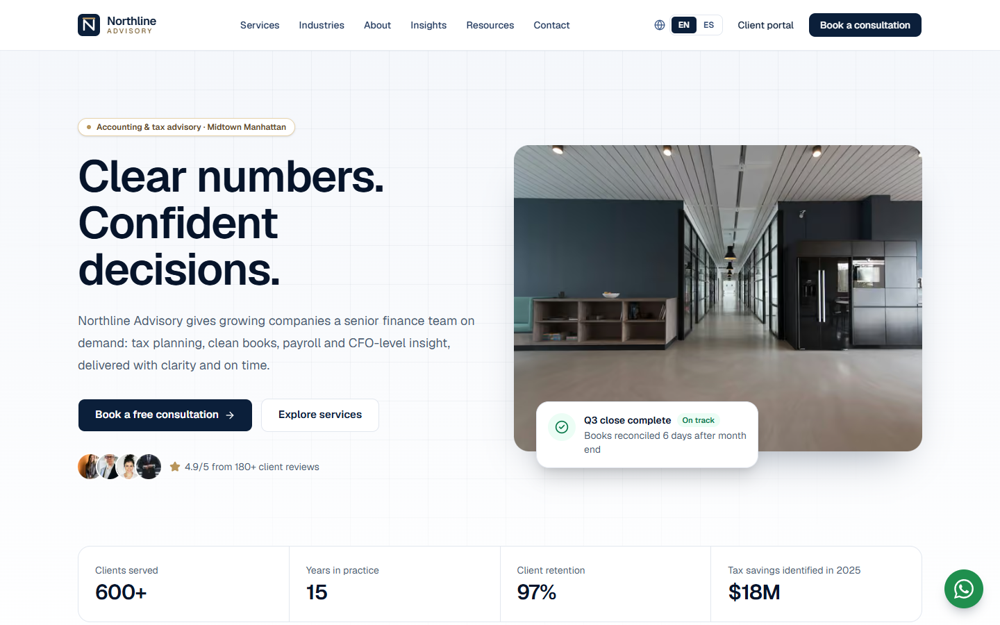
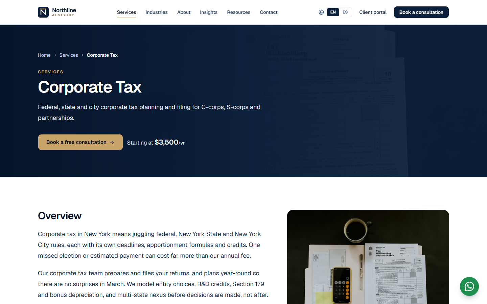
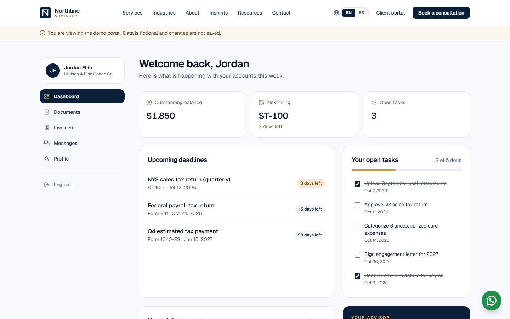

# Northline Advisory

A bilingual (English / Spanish) website and client portal for Northline Advisory, a fictional accounting and tax firm in Midtown Manhattan. It covers the full journey of a modern professional-services firm: service pages, industry expertise, an insights blog, interactive tax calculators, a guided contact flow and a secure-feeling client portal.

**Live demo:** [accounting.ahmadkhajeh.com](https://accounting.ahmadkhajeh.com)

Demo project by Ahmad Khajeh — [ahmadkhajeh.com](https://ahmadkhajeh.com)



## Highlights

- **Fully bilingual:** every page and form message is available at `/en` and `/es`, with hreflang alternates and localized formatting for dates and USD amounts.
- **Six service detail pages:** overview, deliverables, process, pricing and FAQs, plus pages for industries, the team, the firm and its locations.
- **Insights blog:** MDX articles in both languages with categories, tags, reading time, related posts and a client-side category filter.
- **Tax calculators:** a NYC/NY sales tax calculator and a 2026 quarterly estimated-tax calculator for freelancers and sole proprietors, with self-employment tax and federal brackets.
- **Downloadable resources:** PDF guides and a webinar library.
- **Three-step contact wizard:** schema-validated fields, accessible focus handling, a confirmation reference number and a WhatsApp shortcut.
- **Client portal demo:** one-click sign-in, then a dashboard with deadlines and tasks, documents with drag-and-drop upload preview, invoices, messages and a profile form.
- **Built for quality:** Lighthouse scores of 100 for Accessibility, Best Practices and SEO; Open Graph images, JSON-LD structured data, a sitemap and robots rules; responsive from 375 px phones to wide desktops.





## Tech stack

- [Next.js](https://nextjs.org) (App Router) and TypeScript
- [Tailwind CSS v4](https://tailwindcss.com) and [shadcn/ui](https://ui.shadcn.com)
- [Framer Motion](https://motion.dev) for animation
- [next-intl](https://next-intl.dev) for internationalization
- [React Hook Form](https://react-hook-form.com) with [Zod](https://zod.dev) validation
- MDX content via `next-mdx-remote`

## Run locally

```bash
npm install
npm run dev
```

Then open [http://localhost:3000](http://localhost:3000).
